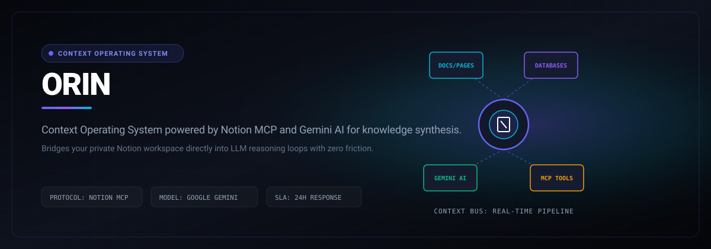

# ORIN

> Context operating system powered by Notion MCP and Gemini AI for knowledge synthesis.

```bash
git clone https://github.com/Luxion-Labs/ORIN.git && cd ORIN && npm install && npm run dev
```



[](https://orin-delta.vercel.app) [](LICENSE) [](CONTRIBUTING.md)

## Overview
Context operating system powered by Notion MCP and Gemini AI for knowledge synthesis. Built by Luxion Labs as part of our high-velocity open-source engineering ecosystem.

## Features
- Seamless Notion workspace integration via standard MCP client protocol.
- Automatic relationship graphs connecting scattered project documents and notes.
- Context-aware answers synthesized directly from private workspace databases.
- High-velocity query caching with real-time change stream detection.

## Architecture and Stack
Model Context Protocol (MCP), Notion API, Google Gemini, Node.js, and React.

## Quickstart
```bash
git clone https://github.com/Luxion-Labs/ORIN.git && cd ORIN && npm install && npm run dev
```

## Maintainer Response SLA
Luxion Labs enforces a strict 24-hour response SLA on all community issues, feature proposals, and pull requests. See [CONTRIBUTING.md](CONTRIBUTING.md) for full development guidelines.

## License
Distributed under the MIT License. See [LICENSE](LICENSE) for more details.
